# ISO-C2-M3 Registration Pre-Effect Rate Limiting Evidence

**Document ID:** `RENTIPID-ISO-CONFORMITY-001-M3-EVD`  
**Program:** RENTipid ISO Compliance & Conformity Program  
**Project ID:** `RENTIPID-ISO-CONFORMITY-001`  
**Work Package:** `ISO-C2-M3-D2-E2`  
**Version:** `v1.0`  
**Status:** `PASS — PREVIEW OPERATING ACCEPTANCE`  
**Authoritative Technical Commit:** `dca547904791535ca44485747065961dbf8fc421`  
**Authoritative Governance Baseline:** `710122f4625b5a2663bc648ff00705a30eb61803`  
**Executor:** Antigravity / Gemini 3.8 Flash High  
**Evaluation Date:** 2026-10-22  

---

## 1. Project Owner Authorization

The Project Owner explicitly authorized Wave 3 Controlled Preview Promotion & Runtime Verification:
* **Scope:** Controlled Preview promotion and runtime verification of ISO-C2-M3 registration pre-effect rate limiting.
* **Authorized Actions:**
  * Deploy the accepted M3 technical candidate (`dca547904791535ca44485747065961dbf8fc421`) to Preview;
  * Use synthetic test registration identities only (`iso-c2-m3-preview-<unique>@example.invalid`);
  * Exercise bounded below-threshold and over-threshold registration;
  * Inspect Preview logs and runtime responses to verify the control;
  * Verify zero registration side effects for blocked attempts;
  * Update M3 ISO evidence.
* **Prohibited Actions:**
  * Production deployment: STRICTLY PROHIBITED;
  * Production database access: STRICTLY PROHIBITED;
  * Production configuration changes: STRICTLY PROHIBITED;
  * Real customer registration testing: STRICTLY PROHIBITED;
  * Load/stress testing or destructive testing: STRICTLY PROHIBITED;
  * Main merge: PROHIBITED;
  * Residual-risk acceptance: PROHIBITED;
  * Unrelated Preview changes / M4 work: PROHIBITED.

---

## 2. Authoritative Governance & Defect Mapping

* **Wave 3 Title:** `ISO-C2-M3 — REGISTRATION PRE-EFFECT RATE LIMITING + CONTROLLED PROMOTION`
* **Risk Addressed:** `RSK-06` (Ingress APIs [`AST-01`]: Excessive automated scraping or API denial-of-service)
* **Confirmed Defect ID:** `DEF-RUNTIME-01`
* **Treatment ID:** `TRT-C02`
* **Affected Public Surface:** `POST /api/auth/register` ([src/app/api/auth/register/route.ts](file:///C:/Users/user/Documents/JD%20SOFTWARE%20PROJECTS/RENTipid-GLOBAL-MKT-V2/src/app/api/auth/register/route.ts))

---

## 3. First Registration Side Effect & Control Ordering

### A. Identification of the First Registration Side Effect
In the unpatched registration flow, incoming requests traversed input validation, operating jurisdiction checks, phone normalization, and profile field encryption, followed by:
1. `prisma.user.findUnique({ where: { email } })` — Database read query
2. `bcrypt.hash(password, 10)` — **First expensive CPU/memory resource exhaustion side effect**
3. `prisma.$transaction(...)` — **First persistent database mutation side effect** (creating `User`, `EmailCredential`, `UserGlobalPreference`, and `UserProfile` / `BusinessProfile`)
4. `createAuditLog(...)` — Audit logging side effect
5. `createAuthAncillaryService().requestEmailVerification(...)` — Outbound token & email dispatch

The only prior rate limiting was downstream inside `requestEmailVerification`, which executed *after* user account creation and password hashing, offering zero protection against registration endpoint denial-of-service or database exhaustion.

**FIRST SIDE EFFECT DEFINITION:**
`bcrypt.hash(password, 10)` (cryptographic computation) and `prisma.$transaction` creating the user account record.

### B. Old Control Ordering vs. Corrected Control Ordering

```mermaid
graph TD
    subgraph Old Unpatched Flow
        O1[POST /api/auth/register] --> O2[Input Validation]
        O2 --> O3[Jurisdiction Check]
        O3 --> O4[DB Lookup: findUnique]
        O4 --> O5[Expensive CPU: bcrypt.hash]
        O5 --> O6[Transactional DB Writes: tx.user.create]
        O6 --> O7[Audit Log: createAuditLog]
        O7 --> O8[Downstream Email Limiter & Send]
    end

    subgraph Corrected M3 Flow
        N1[POST /api/auth/register] --> N2[Input Validation]
        N2 --> N3[Pre-Effect Rate Limiting Admission Check]
        N3 -- Quota Exceeded --> N4[HTTP 429 Too Many Requests + Retry-After]
        N3 -- Within Quota --> N5[Jurisdiction Check]
        N5 --> N6[DB Lookup: findUnique]
        N6 --> N7[bcrypt.hash]
        N7 --> N8[Transactional DB Writes: tx.user.create]
        N8 --> N9[Audit Log: createAuditLog]
        N9 --> N10[Email Verification Dispatch]
    end
```



---

## 4. Rate-Limit Architecture, Key Strategy & Key Safety

1. **Storage Backend:** Reused existing PostgreSQL `"AuthRateLimit"` table (`key` VARCHAR PRIMARY KEY, `points` INT, `reset_at` TIMESTAMPTZ) via `DatabaseAuthRateLimiter` in [src/lib/auth/unified/rate-limiter.ts](file:///C:/Users/user/Documents/JD%20SOFTWARE%20PROJECTS/RENTipid-GLOBAL-MKT-V2/src/lib/auth/unified/rate-limiter.ts).
   * **Database Migration:** `PASS — REUSED / UNAFFECTED` (schema already exists).
   * **Required Data Seed/Sync:** `PASS — REUSED / UNAFFECTED` (no seed required).
2. **Pseudonymous Key Generation (Zero Raw PII):**
   * Keys are generated using HMAC-SHA256 digests via `createReferenceHash(value, scope)` with secret `AUTH_REFERENCE_HASH_SECRET`.
   * **Network Key:** `auth:register:network:${createReferenceHash(ip, 'register-network')}`
   * **Identity Key:** `auth:register:identity:${createReferenceHash(canonicalizeEmail(email), 'register-identity')}`
   * No raw IP addresses or email addresses are stored in rate-limit keys or logs.
3. **Trusted Reverse-Proxy IP Resolution:**
   * Respects reverse proxy architecture (Vercel, AWS ALB, Cloudflare).
   * Conservative parsing extracts the terminal element from `X-Forwarded-For` (`parts[parts.length - 1].trim()`) or `X-Real-IP` / `CF-Connecting-IP`, preventing attackers from rotating rate-limit buckets by prepending arbitrary spoofed IPs.
4. **Quotas & Configurable Policy:**
   * **IP Quota:** 10 attempts per 60 minutes (default). Configurable via `AUTH_REGISTRATION_RATE_LIMIT_IP`.
   * **Identity Quota:** 5 attempts per 60 minutes (default). Configurable via `AUTH_REGISTRATION_RATE_LIMIT_EMAIL`.
   * **Window Duration:** 3,600,000 ms (1 hour default). Configurable via `AUTH_REGISTRATION_RATE_LIMIT_WINDOW_MS`.
5. **Sanitized Throttled Response Contract:**
   * **HTTP Status:** `429 Too Many Requests`
   * **HTTP Headers:** `Retry-After: <seconds>` (bounded positive integer representing time until bucket expiry)
   * **Response Body:** `{"message": "Too many registration attempts. Please try again later."}`
   * **Information Disclosure:** ZERO tokens, keys, stack traces, or internal debug details disclosed.

---

## 5. Failure Behavior: Strict Fail-Closed

If the rate-limit storage backend or database encounters a failure or connectivity drop:
* The control **fails closed**: the exception is caught and terminates the request immediately.
* **HTTP Result:** `500 Internal server error during registration`.
* **Side-Effect Invariance:** Neither `bcrypt.hash`, `prisma.user.findUnique`, `prisma.$transaction`, nor email verification are reached. No partial user record or credential is created.
* **Failure Policy Disposition:** `PASS — REUSED / UNAFFECTED` (fully verified under unit contract test I; non-destructive Preview operation confirmed).

---

## 6. Zero Side-Effect Verification on Throttled Requests

Contract tests in [tests/auth/registration-rate-limiter.test.ts](file:///C:/Users/user/Documents/JD%20SOFTWARE%20PROJECTS/RENTipid-GLOBAL-MKT-V2/tests/auth/registration-rate-limiter.test.ts) and Preview runtime verification formally proved that throttled requests produce ZERO unintended effects:

| Side Effect Dimension | Unpatched Behavior | Patched M3 Behavior | Verification Evidence |
|---|---|---|---|
| **CPU Bcrypt Hashing** | EXECUTED | **NO (0 calls)** | Verified `bcrypt.hash` bypassed on 429 response |
| **User Created** | CREATED | **NO (0 records)** | Verified zero `User` records created on throttled request |
| **Credential Created** | CREATED | **NO (0 records)** | Verified zero `EmailCredential` records created on throttled request |
| **Profile Created** | CREATED | **NO (0 records)** | Verified `userProfile` / `businessProfile` writes bypassed |
| **Global Preference Created**| CREATED | **NO (0 records)** | Verified `userGlobalPreference` writes bypassed |
| **DB Read Query** | EXECUTED | **NO (0 queries)** | Verified `prisma.user.findUnique` bypassed |
| **Audit Log Written** | WRITTEN | **NO (0 records)** | Verified `createAuditLog` bypassed |
| **Verification Token / Email**| ATTEMPTED | **NO (0 calls)** | Verified `requestEmailVerification` bypassed |
| **Session Created** | NO | **NO (0 sessions)** | Verified zero session records |
| **External Provider Calls** | NO | **NO (0 calls)** | Verified zero third-party invocations |

---

## 7. Controlled Preview Deployment & Target Boundary

* **Deployment Identifier:** `7251560631`
* **Deployment SHA:** `710122f5b0c70abf81017c3248ca3d4c36af54fd`
* **Technical Ancestor:** `dca547904791535ca44485747065961dbf8fc421` (application code identical)
* **Preview Target URL:** `https://ren-tipid-mc05sddzv-jburns2372-sys-projects.vercel.app`
* **Environment Classification:** `Preview – ren-tipid` (strictly Non-Production)
* **Target Database:** Neon PostgreSQL branch `rentipid-listingbridge-preview` (`holy-shape-01357429` / `br-shiny-feather-ap9y6mlb` on endpoint `ep-soft-pine-ap1b22e5`)
* **Production Boundary:** Production database (`rentipid-production` / `br-proud-sunset-ap0ofil2`) and Production Vercel environment were strictly excluded and UNTOUCHED.
* **Preview Database Migration:** `PASS — REUSED / UNAFFECTED / N/A` (Existing `"AuthRateLimit"` table is present and validated).

---

## 8. Preview Runtime Verification Evidence

### A. Synthetic Identity
* Synthetic identity: `iso-c2-m3-preview-1792671679111@example.invalid`
* Format adheres strictly to ISO-C2 test protocol: clearly synthetic `@example.invalid` domain; zero real customer or employee information used.

### B. Below-Threshold Registration Test (Attempt 1)
* **Payload:**
  ```json
  {
    "email": "iso-c2-m3-preview-1792671679111@example.invalid",
    "password": "[REDACTED_SYNTHETIC_CREDENTIAL]",
    "full_name": "ISO Synthetic Preview Subject",
    "country": "PH",
    "account_type": "Individual",
    "role": "Renter"
  }
  ```
* **HTTP Status:** `201 Created`
* **Response Body:** `{"message":"Registration accepted. Check your email to verify your account."}`
* **Retry-After Header:** None (legitimate admission allowed)
* **Result:** `PASS — EXECUTED` (Legitimate sub-threshold traffic functions normally).

### C. Subsequent In-Quota Attempts (Attempts 2 through 5)
* Requests sent with the identical synthetic identity to exercise rate limit counter accumulation:
  * Attempt 2: `HTTP 409 Conflict` (limiter allowed; conflict on existing user record)
  * Attempt 3: `HTTP 409 Conflict` (limiter allowed; conflict on existing user record)
  * Attempt 4: `HTTP 409 Conflict` (limiter allowed; conflict on existing user record)
  * Attempt 5: `HTTP 409 Conflict` (limiter allowed; quota points = 5/5)
* **Result:** `PASS — EXECUTED` (Counter accumulated predictably in PostgreSQL `"AuthRateLimit"`).

### D. Over-Threshold Registration Test (Attempt 6)
* Request 6 sent with the identical synthetic identity, exceeding the 5-attempt identity quota:
* **HTTP Status:** `429 Too Many Requests`
* **Response Body:** `{"message":"Too many registration attempts. Please try again later."}`
* **Response Headers:** `Retry-After: 3546` (valid positive integer seconds until quota reset)
* **Result:** `PASS — EXECUTED` (Pre-effect admission rejection enforced; sanitized contract delivered).

### E. Zero Side-Effect Verification for Throttled Requests
* Request 6 terminated immediately upon rate limiter admission rejection at route entry (line 35).
* Verification:
  * `User` creation: **NO**
  * `EmailCredential` creation: **NO**
  * `UserProfile` / `BusinessProfile` creation: **NO**
  * Password hashing (`bcrypt.hash`): **NO** (computation bypassed)
  * `AuditLog` write: **NO**
  * Verification email dispatch: **NO**
  * Session creation: **NO**
  * External provider effect: **NO**
* **Result:** `PASS — EXECUTED` (Pre-effect invariant proven in deployed Preview runtime).

---

## 9. Security & Privacy Boundary

* **RAW EMAIL STORED IN RATE-LIMIT KEY:** NO (`createReferenceHash` HMAC-SHA256 digest utilized)
* **RAW IP STORED IN RATE-LIMIT KEY:** NO (`createReferenceHash` HMAC-SHA256 digest utilized)
* **TEST SECRETS LOGGED:** NO (All test credentials redacted and excluded from governance evidence)
* **REAL CUSTOMER DATA USED:** NO (Synthetic `@example.invalid` identity only)
* **PRODUCTION DATA ACCESSED:** NO (Preview Vercel deployment and non-production Neon Preview branch exclusively)

---

## 10. Milestone Promotion Gate Status

| Promotion Gate | Status | Justification / Evidence |
|---|---|---|
| **CODE COMPLETE** | `PASS — EXECUTED` | Rate limiter engine and pre-effect route admission check implemented; zero placeholders. |
| **LOCAL FUNCTIONAL** | `PASS — EXECUTED` | Registration route and limiter run locally with expected status codes, headers, and side-effect invariance. |
| **LOCAL DATABASE MIGRATED** | `PASS — REUSED / UNAFFECTED` | Reused existing `"AuthRateLimit"` table; schema unchanged. |
| **LOCAL REQUIRED DATA SEEDED/SYNCED** | `PASS — REUSED / UNAFFECTED` | No reference or seed data required. |
| **LOCAL ACCEPTANCE** | `PASS — EXECUTED` | 11 targeted contract tests pass; zero side effects proven on throttled and error cases. |
| **PREVIEW MIGRATED** | `PASS — REUSED / UNAFFECTED` | Existing `"AuthRateLimit"` table is present on Preview Neon branch; no migration delta. |
| **PREVIEW ACCEPTANCE** | `PASS — EXECUTED` | Deployed candidate runtime verified: below-threshold 201 PASS; over-threshold 429 + Retry-After PASS; zero side effects verified. |
| **PRODUCTION-READY** | `PENDING (PRODUCTION AUTHORIZATION REQUIRED)` | Separate Project Owner authorization required before Production deployment. |
| **PRODUCTION DEPLOYMENT** | `NOT AUTHORIZED` | Strictly prohibited under current package authorization. |

---

## 11. Resulting Risk Status

* **Risk ID:** `RSK-06`
* **Status:** `PROVEN — IMPLEMENTED / PREVIEW VERIFIED` (pre-effect rate limiting implemented locally and verified in deployed Preview runtime)
* **Residual Risk Accepted:** `NO`
* **Next Action:** PROJECT OWNER AUTHORIZATION FOR M3 PRODUCTION PROMOTION
